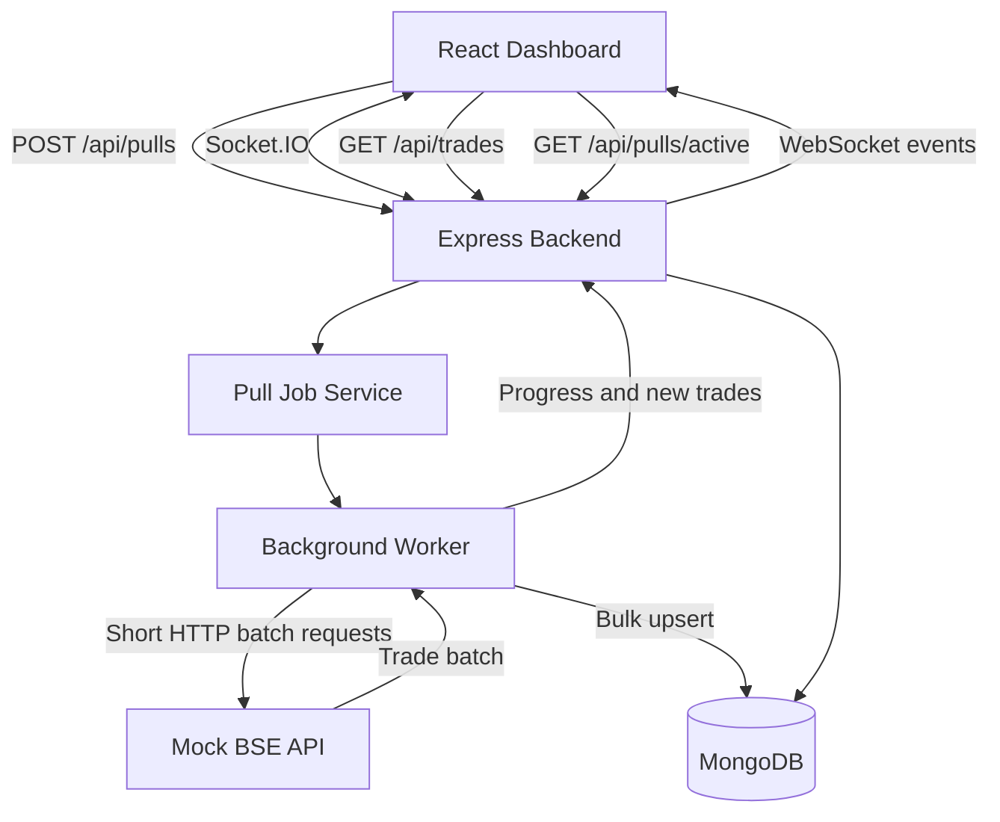

# BSE TradeFlow – Architecture Note

## 1. Design Objective

The architecture is designed to retrieve a large trade dataset over a network where HTTP connections are terminated after 30 seconds.

A full data pull may require approximately 15 minutes. Therefore, the design avoids a single long-running HTTP request and uses independent batch requests handled by a background worker.

## 2. Architecture Diagram

## 3. Component Responsibilities

### React Dashboard
Displays stored trades, synchronization progress, and connection status. It listens for WebSocket events to update the interface without manual refresh.

### Express Backend
Provides REST endpoints, creates pull jobs, retrieves stored trade records, and manages WebSocket communication.

### Background Worker
Retrieves trade records in batches, validates the response structure, persists the records, and emits progress updates.

### Mock BSE API
Simulates the exchange API and provides paginated trade records. It contains 3,000 seeded records and supports configurable response delays.

### MongoDB
Stores trade records and pull-job metadata. Unique trade IDs and upserts help make repeated pulls idempotent.

### Socket.IO
Provides real-time delivery of newly inserted trades, pull progress, and completion or failure notifications.

## 4. Why Batch Processing?

A single request that remains open for 15 minutes would exceed the 30-second network limit.

Instead, the worker makes multiple short requests, each retrieving a limited number of records. Every request completes independently, so no individual request needs to remain open for the full operation.

## 5. Why WebSockets?

Periodic polling and manual refresh are unnecessary for live updates.

WebSockets provide a persistent communication channel for server-initiated updates. The backend emits new trade records and progress events whenever a batch is processed.

## 6. Why MongoDB?

MongoDB provides persistent storage for both trade records and pull-job progress. This allows the dashboard to load previously retrieved records while a new pull is running.

## 7. Limitations and Production Improvements

The assessment implementation runs the worker in the backend process. For production use, a durable queue such as BullMQ with Redis or a separately managed worker should be introduced so jobs can recover after backend restarts.

Additional improvements include authentication, retry policies, structured logs, and monitoring.